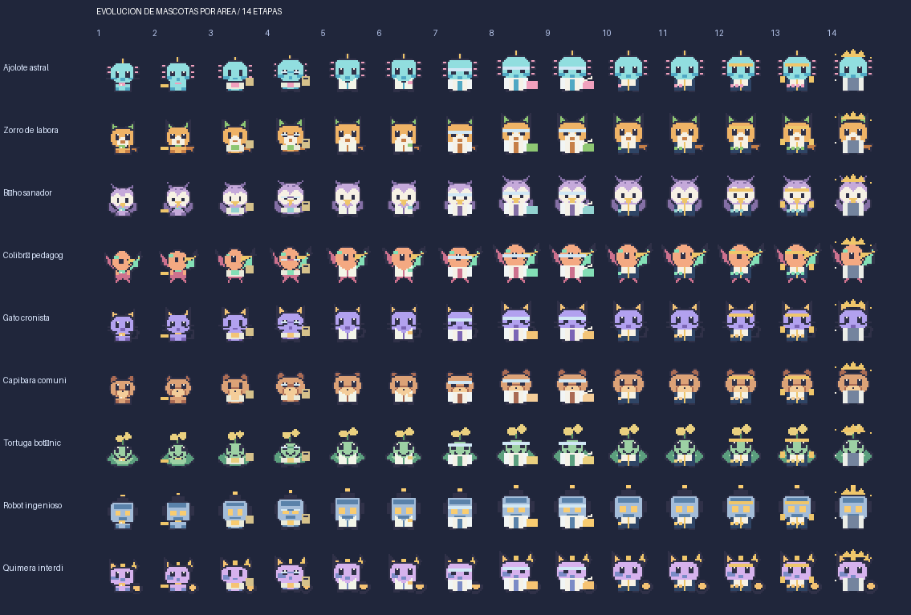

# Avatares, 14 evoluciones y escenarios

## Vista previa

## Especies y procedencia

**Nueve especies originales**, una por área. Cada una está representada como un sprite SVG de **448 × 32 px** que contiene **14 cuadros de 32 × 32 px**. Los nombres son del juego, las áreas se basan en los lineamientos SNII de 2026.

- Contrato de especies: `src/data/pet-visuals.ts`.
- Arte reproducible: `scripts/generate-pets.py` (Pillow opcional solo para regenerar recursos).
- Recursos publicados: `public/pets/{areaId}.svg`.
- Escenario de cada una de las 14 etapas y seis estaciones: `src/data/scene-world.ts`.
- Ambientación de cada área y retos específicos: `src/data/area-routes.ts`.
- Animaciones de bienestar y reacciones: `src/ui/pet-animation.ts`, `src/styles.css`.

No se debe cambiar la clave de un SVG sin migrar `areaId` de las partidas anteriores.

## Principios visuales

La especie conserva una silueta identificable desde Kínder hasta Emérito; vestuario y accesorios indican crecimiento, no supuestas capacidades de investigación oficiales. Colibrí pedagogo y Quimera interdisciplinaria añaden diferencias visibles a Conducta/Educación e Interdisciplinaria.

El movimiento hacia las estaciones es una animación UI, no una simulación física. La selección no modifica PA, CR o UPE; el comando posterior confirma la actividad.

## Accesibilidad y pendientes

Respetar `prefers-reduced-motion`, la opción de pausar animaciones y foco de teclado. La información crítica de necesidades se comunica también por texto. **Faltan pruebas visuales reales en móviles y pruebas con lectores de pantalla**.

Ver [Áreas y rutas](AREAS_Y_RUTAS.md) y [Pedagogía](PEDAGOGIA_Y_ESTACIONES.md).
